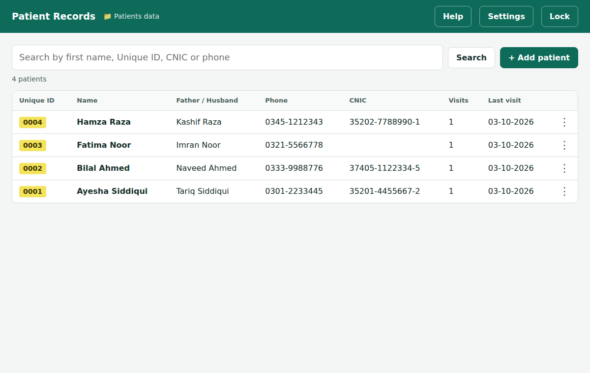

**English** | [اردو](README.ur.md)

# Patient Records

A free app for keeping your clinic's patient records on your own computer. It needs no internet, no account and no installation.

> [!IMPORTANT]
> **This app is free. Selling it is not allowed.**
> Anyone can use it for free, including private clinics. Nobody may sell it, charge money for it, or include it in anything they sell. If someone charged you for this app, they broke its [license](LICENSE).

## What it can do

- Save each patient's details: name, CNIC, phone, father's name and more
- Record every visit, with the date and time added for you
- Keep photos of prescriptions and reports in each patient's own folder
- Find a patient by first name, ID number, CNIC or phone number
- Save everything in an Excel file that you can open at any time

## What you need

- A Windows or Mac computer
- Google Chrome or Microsoft Edge. Both are free, and Edge is already on most Windows computers.

The app does not work on phones, or in Safari or Firefox.

## Step 1: Download the app

1. Click here: **[Download Patient Records](../../releases/latest/download/Patient_Records.html)**
2. If your browser asks whether to keep the file, click **Keep**.
3. Open your **Downloads** folder and move **Patient_Records.html** to your Desktop, so it's easy to find.

If the download link doesn't work, click the green **Code** button at the top of this page, then **Download ZIP**. Right-click the ZIP file and choose **Extract All** (on a Mac, double-click it). The app is inside the **dist** folder.

## Step 2: Open the app

- **Windows:** right-click the file, choose **Open with**, then **Google Chrome** or **Microsoft Edge**.
- **Mac:** right-click the file, choose **Open With**, then **Google Chrome**.

## Step 3: First-time setup

1. **Make a folder for your records.** In your Documents folder, make a new folder named **Clinic**.
2. **Create a password** and type it again.
3. **Save your recovery code.** Write it on paper or click **Save as file**. You need it if you forget your password. Tick the box, then click **Continue**.
4. **Choose your folder.** Click **Choose folder**, pick the **Clinic** folder, and click **Allow** when asked.

You're ready. From now on, open the app and type your password.

## Everyday use

| To do this | Do this |
| --- | --- |
| Add a new patient | Click **+ Add patient**, type the name (everything else is optional), then click **Save patient** |
| Add a visit | Click the patient, then **+ Add visit** |
| Add prescription photos | Click **Choose images** in the patient or visit form |
| Find a patient | Type a first name, ID, CNIC or phone number in the search box |
| See a visit's photos | Click the patient, then click the visit |
| Edit or delete | Click **⋮** next to the patient or visit |

The date and time of each visit are added for you.

## Keep your records safe

- **Back up every week.** Copy the **Patients data** folder to a USB drive. If the computer breaks, this copy is your only backup.
- **Close Excel before saving.** You can open **PatientData.xlsx** in Excel, but close it before you save anything in the app.
- **Put a password on your computer.** The app's password only locks the app. Anyone who opens the Patients data folder can read your records, so your computer needs its own password too.
- **Deleting is safe.** Deleted patients move to a **Deleted** folder. Nothing is erased.

## If you forget your password

Click **Forgot password?** on the lock screen, then do one of these:

- type your **recovery code**, or
- open the **Patients data** folder, delete the file **Delete this file to reset password.txt**, then click **I deleted the file**.

Then set a new password. Your records are not affected.

## Need more help?

- Click **Help** inside the app.
- Read the full [user guide](docs/USER_GUIDE.md).

## Disclaimer

- **Not for sale.** This app is free. Selling it, charging for it, or including it in a paid product or service is not allowed. See the [license](LICENSE).
- **No warranty.** The app is provided as it is. The author is not responsible for lost data or any other problem. Keep regular backups.
- **Not medical advice.** This is a record-keeping tool. It does not give medical advice and is not a medical device.
- **Your legal duties.** Check the rules for keeping patient records where you work. The Punjab Healthcare Commission asks clinics to keep general records for at least 1 year, and medico-legal records for 12 years or longer.

## For developers

The code is in the `src` folder. [DEVELOPERS.md](DEVELOPERS.md) explains how it works and how to change it.

Copyright (C) 2026 Daniyal
